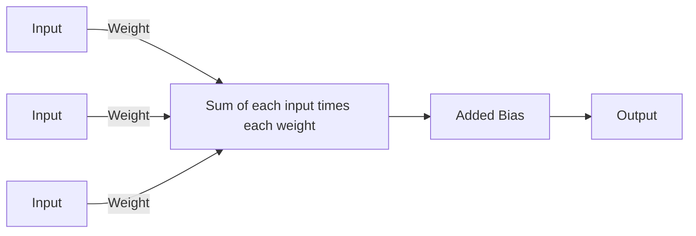
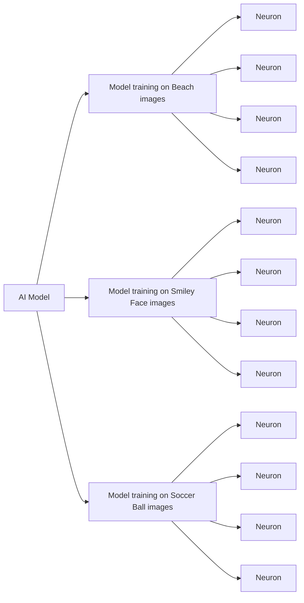

# Building AI with Makecode Arcade

- [Introduction](#intro)
- [How to run this Project?](#how-to-run-this-project)
- [Explanation](#explanation)
- [Tech Used 💻](#tech-used-)

### Intro

Welcome to my AI Image Generation model built entirely on the PXT Framework.
This project includes:

- 🧠 **A 60 parameter** network of 4x3 independently trained neurons
- 📈 Next pixel prediction for **training the model**
- 💾 Three built in datasets, **totaling up to 150 samples** for training the AI
  
If you're wondering, [main.ts](https://akishyan-premaharan.github.io/procedural-image-engine/blob/master/main.ts) is the project source code.

## How to run this Project?

You can:

- Play my project [**here at Github.io**](https://akishyan-premaharan.github.io/procedural-image-engine/)

- Add it as a MakeCode Arcade Extension
  - Open [**MakeCode Arcade**](https://arcade.makecode.com/)
  - Click on New Project
  - Click on Extensions under the gear menu
  - Search for **https://github.com/akishyan-premaharan/procedural-image-engine** and import

- Edit my project at [**MakeCode Arcade**](https://arcade.makecode.com/), where you
   - Click on Import then click on Import URL
   - Paste **https://github.com/akishyan-premaharan/procedural-image-engine** and click import

## Explanation

### Diagram of a single Neuron

### Diagram of the AI Model
  

## Tech Used 💻

|Name|Usage|
|----|-----|
||The language used to code the AI|
||The **IDE**|
||The IDE **Framework** that along with Github, helped automatically create this repo|
||**Automatically created** this repo with PXT|

